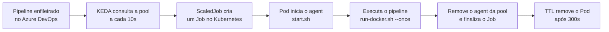

<div align="center">

# ⚡ KEDA + Azure Pipelines Agents

### Autoscaling de agents self-hosted do Azure Pipelines no Kubernetes


[📖 Leia o artigo completo no Medium](https://medium.com/@luisfroliveira/autoscaling-de-agents-self-hosted-no-azure-pipelines-com-keda-1a44bdda3df0)

</div>

---

## 📌 Sobre o projeto

Este repositório mostra como rodar **agents self-hosted do Azure Pipelines como Jobs efêmeros no Kubernetes**, escalando de **0 até N** de acordo com a fila de pipelines, usando o **[KEDA](https://keda.sh/)** (`ScaledJob` + scaler `azure-pipelines`).

**Por que usar?**

- 💸 **Economia:** sem pipeline na fila, não há agent rodando.
- 🚀 **Elasticidade:** várias execuções em paralelo, limitadas por `maxReplicaCount`.
- 🧹 **Ambiente limpo:** cada Job executa **um único pipeline** (`--once`) e é descartado.
- 🔧 **Customizável:** instale no `Dockerfile` as ferramentas que seus pipelines precisam.

## 🧩 Como funciona



1. Um pipeline é enfileirado na pool (`lab-keda`).
2. O KEDA detecta a demanda via API do Azure DevOps.
3. O `ScaledJob` cria um Job com a imagem do agent.
4. O `start.sh` baixa o agent mais recente, registra na pool e executa **um job**.
5. Ao terminar, o agent se remove da pool e o Job é limpo após `ttlSecondsAfterFinished`.

> 🧬 **Template agent:** o `job-template.yml` registra um agent cujo nome contém `template`. Ele serve de modelo para a pool (e suas *capabilities*) e, por isso, **sai logo após a configuração, sem ser removido**. O `start.sh` identifica esse caso pelo nome.

## 📁 Estrutura do repositório

```text
.
├── container-agent/
│   ├── Dockerfile        # Imagem do agent (Ubuntu 22.04)
│   └── start.sh          # Registro, execução e limpeza do agent
└── kubernetes/
    ├── secret.yml        # URL da organização, PAT e nome da pool
    ├── job-template.yml  # Job que registra o template agent
    └── scaledjob.yml     # ScaledJob do KEDA (autoscaling)
```

## ✅ Pré-requisitos

- Cluster Kubernetes (AKS, kind, minikube, etc.) e `kubectl` configurado
- [KEDA](https://keda.sh/docs/deploy/) instalado no cluster
- Organização no **Azure DevOps** com uma **Agent Pool** criada (ex.: `lab-keda`)
- **PAT** com permissão **Agent Pools (Read & manage)**
- Docker, caso queira construir a própria imagem

## 🚀 Passo a passo

### 1. Instalar o KEDA

```bash
helm repo add kedacore https://kedacore.github.io/charts
helm repo update
helm install keda kedacore/keda --namespace keda --create-namespace
```

### 2. Criar a Agent Pool no Azure DevOps

Em **Organization settings → Pipelines → Agent pools → Add pool**, escolha **Self-hosted** e use o nome `lab-keda` (ou outro, ajustando os manifestos).

### 3. (Opcional) Construir e publicar a imagem

```bash
cd container-agent
docker build -t <seu-usuario>/azure-pipelines-agent-keda:latest .
docker push <seu-usuario>/azure-pipelines-agent-keda:latest
```

Se usar outra imagem, atualize o campo `image` em `kubernetes/job-template.yml` e `kubernetes/scaledjob.yml`.

### 4. Configurar o Secret

Edite `kubernetes/secret.yml`:

| Variável | Descrição | Exemplo |
| :--- | :--- | :--- |
| `AZP_URL` | URL da organização | `https://dev.azure.com/minha-org` |
| `AZP_TOKEN` | PAT com permissão em Agent Pools | `********` |
| `AZP_POOL` | Nome da pool | `lab-keda` |

> ⚠️ **Nunca faça commit do seu PAT.** Mantenha o arquivo com valores de exemplo e aplique os valores reais localmente, ou crie o Secret direto pelo `kubectl`:
>
> ```bash
> kubectl create secret generic pipeline-auth -n azure-devops \
>   --from-literal=AZP_URL=https://dev.azure.com/minha-org \
>   --from-literal=AZP_TOKEN=<seu-pat> \
>   --from-literal=AZP_POOL=lab-keda
> ```

### 5. Aplicar os manifestos

```bash
kubectl create namespace azure-devops

kubectl apply -f kubernetes/secret.yml
kubectl apply -f kubernetes/job-template.yml   # registra o template agent
kubectl apply -f kubernetes/scaledjob.yml      # ativa o autoscaling
```

Confira no Azure DevOps se o agent `azure-template` aparece na pool.

### 6. Usar a pool em um pipeline

```yaml
trigger: none

pool:
  name: lab-keda

steps:
  - script: |
      echo "Rodando em um agent efêmero no Kubernetes 🚀"
      hostname
    displayName: Hello KEDA
```

Dispare o pipeline várias vezes e acompanhe o escalonamento:

```bash
kubectl get jobs,pods -n azure-devops -w
```

## ⚙️ Configurações principais do `ScaledJob`

| Campo | Valor | Função |
| :--- | :---: | :--- |
| `pollingInterval` | `10` | Intervalo (s) de consulta à fila |
| `maxReplicaCount` | `10` | Máximo de agents simultâneos |
| `ttlSecondsAfterFinished` | `300` | Tempo até remover Jobs concluídos |
| `successfulJobsHistoryLimit` | `5` | Jobs com sucesso mantidos no histórico |
| `failedJobsHistoryLimit` | `5` | Jobs com falha mantidos no histórico |
| `rollout.strategy` | `gradual` | Atualização gradual dos Jobs |

## 🔍 Solução de problemas

| Sintoma | O que verificar |
| :--- | :--- |
| `missing AZP_URL` / `missing AZP_TOKEN` | Secret `pipeline-auth` criado no namespace `azure-devops` |
| `could not determine a matching Azure Pipelines agent` | URL da organização correta e PAT válido |
| Nenhum Job é criado | Nome da pool igual em `AZP_POOL` e `poolName`, e logs do KEDA (`kubectl logs -n keda -l app=keda-operator`) |
| Pipeline fica aguardando agent | Template agent registrado na pool (nome contendo `template`) |
| Pods acumulando | Revise `ttlSecondsAfterFinished` e os limites de histórico |

## 🔒 Boas práticas

- Use um **PAT dedicado**, com o menor escopo possível e prazo de expiração curto.
- Prefira um gerenciador de segredos (Azure Key Vault + CSI Driver, External Secrets, Sealed Secrets).
- Evite `latest` em produção: fixe a versão da imagem.
- Defina `resources.requests/limits` nos Pods do agent.

## 📚 Referências

- 📝 [Artigo: Autoscaling de agents self-hosted no Azure Pipelines com KEDA](https://medium.com/@luisfroliveira/autoscaling-de-agents-self-hosted-no-azure-pipelines-com-keda-1a44bdda3df0)
- [KEDA — Azure Pipelines scaler](https://keda.sh/docs/latest/scalers/azure-pipelines/)
- [Agents self-hosted Linux no Azure Pipelines](https://learn.microsoft.com/azure/devops/pipelines/agents/linux-agent)
- [Agents em containers Docker](https://learn.microsoft.com/azure/devops/pipelines/agents/docker)

## 👨‍💻 Autor

**Luis Felipe Oliveira** · DevOps Engineer

[](https://www.linkedin.com/in/luis-felipe-oliveira/)
[](https://medium.com/@luisfroliveira)

---

<div align="center">

⭐ *Se este projeto ajudou você, deixe uma estrela!* ⭐

</div>
